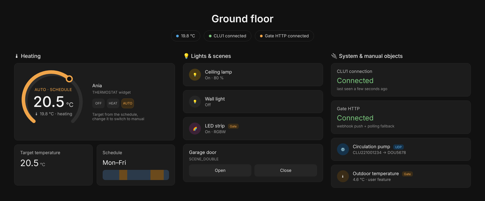

# Home Assistant Grenton

> Fork of [k911/homeassistant-grenton](https://github.com/k911/homeassistant-grenton) (itself based on [sszczep/homeassistant-grenton](https://github.com/sszczep/homeassistant-grenton)) with manually added objects over UDP or Gate HTTP, Gate webhook push and import-time naming.

[](https://github.com/hacs/integration)
[](https://github.com/wirczur/homeassistant-grenton/releases)
[](https://github.com/wirczur/homeassistant-grenton/graphs/commit-activity)

Custom Home Assistant integration for **Grenton Smart Home** system. Seamlessly connect and control your Grenton devices through Home Assistant with automatic discovery, real-time updates, and full configuration support.



## ✨ Features

- **🔌 Automatic Device Discovery** - Connects to Grenton Object Manager and automatically discovers all configured devices
- **CLU Controllers and Scripts** - Discovers every CLU from the imported interface and runs its scripts with dynamic typed arguments
- **🏠 Multiple Widget Types** - Support for lights, switches, dimmers, sensors, covers, and more
- **Thermostats** - `THERMOSTAT_V2` climate entities with heating, optional cooling, a weekly schedule editor, temperature readings, and activity status
- **⚙️ Per-Entity Configuration** - Customize device class and unit of measurement for each supported entity through the UI
- **🔄 Real-time Updates** - Automatic state synchronization with Grenton system
- **🌍 Multi-language Support** - Fully translated UI in English and Polish
- **📱 Modern UI** - Native Home Assistant integration with clean configuration flows

## 📦 Supported Widgets

| Widget Type (Literal) | Description |
|-----------------------|-------------|
| **VALUE_V2** | Single value exposed as a configurable `sensor` or `binary_sensor`. |
| **VALUE_DOUBLE** | Two values (A/B), each independently configurable as `sensor` or `binary_sensor`. |
| **ON_OFF** | Single relay exposed as a configurable `switch` or on/off `light` (automatically detected from name/icon). |
| **ON_OFF_DOUBLE** | Dual relays with each channel configurable as `switch` or on/off `light`. |
| **DIMMER_V2** | Dimmable light exposed as `light` with brightness (0-100%). |
| **LED** | LED or RGB/RGBW light exposed as `light` with brightness and color where available. |
| **CONTACT_SENSOR** | Contact/door/window sensor exposed as `binary_sensor`. |
| **CONTACT_SENSOR_DOUBLE** | Dual contact channels exposed as two `binary_sensor` entities. |
| **SLIDER** | User-configurable numeric control exposed as `number` (slider/box/auto modes). |
| [**THERMOSTAT_V2**](#thermostat-thermostat_v2) | Thermostat exposed as `climate`, with optional cooling, manual targets, editable weekly schedules, temperature/activity feedback, and a read-only Schedule sensor. |
| **MULTISENSOR** | Composite multi-channel sensor mapped to multiple `sensor` entities (as provided). |
| **ROLLER_SHUTTER** | Legacy roller shutter exposed as `sensor` (state enum) plus a `button` action entity. |
| **ROLLER_SHUTTER_V3** | Roller shutter V3 exposed as a single `cover` entity (position; lamel/tilt when available). |
| **CAMERA** | Camera stream exposed as `camera`. |
| **SCENE** | Scene buttons with configurable script, method, attribute, or variable actions and arguments. |
| **SCENE_DOUBLE** | Two scene buttons (e.g. open/close) exposed as `button` entities, configurable like SCENE. The widget JSON is parsed tolerantly; if yours is skipped, attach the integration diagnostics to an issue. |

See [Device specifications](#device-specifications) for detailed behavior and setup.

## 🚀 Installation

Requires **Home Assistant 2026.9.4 or newer**, the tested baseline.

### Option 1: HACS (Recommended)

Requires **HACS 2.0.5 or newer**.

1. Open **HACS** in Home Assistant
2. Click the three dots in the top right corner and select **Custom repositories**
3. Enter `https://github.com/wirczur/homeassistant-grenton`
4. Select **Integration** as the category and click **Add**
5. Open **Grenton** from the added repository and download it
6. Restart Home Assistant

[](https://my.home-assistant.io/redirect/hacs_repository/?owner=wirczur&repository=homeassistant-grenton&category=integration)

HACS installs the integration into `/config/custom_components/grenton`.
When switching from another fork, use only one Grenton repository in HACS.
Keep the existing Grenton integration entry under **Devices & Services**;
this fork uses the same `grenton` domain.

### Option 2: Manual Installation

1. Download the latest release from the [Releases](https://github.com/wirczur/homeassistant-grenton/releases) section
2. Extract the zip file
3. Copy the contents of `custom_components/homeassistant_grenton` into `/config/custom_components/grenton/` (create the `grenton` directory if needed)
4. Restart Home Assistant

## 📖 Configuration

### Initial Setup

1. Go to **Settings** → **Devices & Services**
2. Click **Add Integration**
3. Search for **"Grenton"**
4. Enter your Grenton Object Manager connection details:
   - **IP Address**: IP address of your Grenton Object Manager
   - **Port**: Port number (default: `9998`)
   - **PIN**: Your Object Manager PIN code

### Entity Configuration

After initial setup, you can customize individual entities:

1. Navigate to **Settings** → **Devices & Services** → **Grenton**
2. Click **Configure** on the integration
3. Choose **Configure entities**, then select an entity. Use **Entity type** to
   filter the list; **All entities** is selected by default.
4. Configure entity properties:
   - **Sensors**: Choose device class and unit of measurement
   - **Sliders (Numbers)**: Set display mode, device class, and unit
   - **Binary Sensors**: Select appropriate device class
   - **On/Off controls**: Choose whether the entity is a switch or a light
   - **Dimmers**: Configure the brightness source, native range, and ON/OFF/brightness commands
   - **Scenes**: Review or change the action call type, CLU, script/object name, index, and arguments/value
   - **Thermostats**: Enable cooling, select the control direction, and edit weekly schedules

The integration intelligently filters available options based on your selections and automatically skips unnecessary configuration steps.

With sensor device class **None**, choose **%**, enter a custom unit, or select
**None** for no unit. This also applies to custom CLU variable sensors.

Choose **Configure → Configure CLU**, select a controller, then
**Connection and polling**, and set its
**Polling interval** (default **60 seconds**, whole seconds from 1 to 86400).
Each CLU has its own interval: for example, the main CLU can poll temperatures
every 60 seconds while HTTP Gate polls every 5 seconds. Saving changes only
that CLU’s polling timer, without reconnecting it or restarting other CLUs.
An earlier global interval is retained as the fallback for CLUs without their
own setting. Use **Configure entities** for individual entity settings.

**Initial subscription ID** defaults to **1** (whole numbers from 1 to 65535).
The first group uses this ID; new groups receive successive IDs on the same
report listener. Allocation wraps after 65535 and never reuses an ID during
that listener's lifetime.
Changing this setting removes the old groups before applying the new range.

Widget devices are automatically named from their entity labels. Two distinct
labels are joined with `·`; devices with more labels show the first two and
`(+N)` for the remaining ones. The widget type remains in the Model field.
You can rename a device using Home Assistant's native device settings.
The name is respected across reloads and interface refreshes. Renaming preserves
the device's room, entity IDs and entity labels, and does not reload the integration.
For a widget with one entity, its default friendly name follows the device name
without repeating the label. Widgets with multiple entities keep their individual
entity labels, and existing custom entity names remain unchanged.

### Names, areas, units and precision (during import)

During setup and reconfiguration you can tick **Customize names, areas, units
and precision**. You then get one form per interface page:

- **Area** of the page (becomes the suggested area of its devices),
- one section per widget with the **device name**; for widgets with several
  entities also the **friendly name** of each entity,
- for sensors: **device class**, **unit** (pick or type your own) and
  **precision** (decimals shown in HA); for binary sensors: **device class**.

Fields are prefilled with the current values, so leaving them unchanged keeps
the defaults. The same form is available later in
**Configure → Names, units and precision**. Friendly names are applied like a
rename in the HA UI (entity registry name); a name you later change in HA
itself is kept.

### Manually added objects (UDP or Gate HTTP)

Objects that are not widgets in the myGrenton interface can be added in
**Configure → Add object manually** using the `CLU->OBJECT` identifier
(e.g. `CLU221001234->DOU5678`, `CLU221001234->myScript` for a button,
`CLU221001234->myFeature` for a user feature/variable).

Supported kinds: switch / on-off light (DOUT), dimmer (DIMMER), LED RGB,
LED RGBW, single LED channel (R/G/B/W), roller shutter, thermostat
(THERMOSTAT → climate), sensor, binary sensor, script button. Z-Wave objects
(`ZWA…`) are detected by name and use their own indexes (dimmer, LED colour,
roller shutter without tilt).

Each object chooses its connection:

| Connection | Requirements | State updates |
|---|---|---|
| **UDP** | CLU present in the imported interface | instant (CLU subscription) |
| **Gate HTTP** | GATE HTTP module + HttpListener below | polling (Gate settings) |

#### Migrating from Grenton Objects

If you used [Grenton Objects](https://github.com/jnalepka/grenton-objects-home-assistant),
open **Configure → Import from Grenton Objects**. Every object becomes a
manual object here (UDP when its CLU is in the myGrenton interface, otherwise
Gate HTTP, whose URL is copied). With **Take over entities** the old entries
are removed and the new entities keep the same `entity_id`, name, icon, area,
aliases and labels, so automations and dashboards keep working. Variables kept
on the Gate itself (no `CLU->` part) cannot be imported and stay as they are.

#### Connection status

Every CLU and the Gate HTTP get a diagnostic **connectivity** binary sensor
(e.g. `binary_sensor.<clu_name>`, `binary_sensor.grenton_gate_http`). A CLU is
offline after 3 missed pings (~15 s) and before it first answers after a HA
restart; the Gate is offline when a poll fails. Entities of an offline CLU or
Gate become `unavailable`. Useful e.g. in Node-RED to restore states after a
power failure.

#### Diagnostics

**Settings → Devices & services → Grenton → ⋮ → Download diagnostics** gives the
interface JSON (PIN and encryption keys redacted), the exact validation error
of every skipped widget, CLU status and manual objects – attach it to issues.

#### Gate HTTP setup

1. On the Gate create an `HttpListener` virtual object named
   `HA_Integration_Listener`, path `/HAlistener`, ResponseType `JSON`.
2. Attach a script to its `OnRequest` event that evaluates each JSON value as
   Lua and returns the results under the same keys, plus `g_status = "OK"`.
   The format is compatible with the listener used by
   [Grenton Objects](https://github.com/jnalepka/grenton-objects-home-assistant),
   so an existing listener can be reused as is.
3. In **Configure → Gate HTTP settings** enter the listener URL,
   e.g. `http://192.168.1.50/HAlistener`.

#### Instant updates from the Gate (webhook)

Polling works out of the box. For instant state changes enable
**Receive changes from the Gate via webhook** in the Gate settings; the form
then shows the webhook URL (`http://<HA>:8123/api/webhook/<id>`, LAN only).
The Gate sends a JSON `POST` with one update or a list of them:

```json
{"clu": "CLU221001234", "object": "DOU5678", "index": 0, "value": 1}
[{"id": "CLU221001234->THE0001", "index": 12, "value": 21.5},
 {"clu": "CLU221001234", "variable": "trybDomu", "value": 2}]
```

Example on the Gate: an `HttpRequest` virtual object `HA_Webhook`
(Host `http://<HA>:8123`, Path `/api/webhook/<id>`, Method `POST`,
RequestType/ResponseType `JSON`) and a script `HA_Push(clu, object, index, value)`:

```lua
GATE_HTTP->HA_Webhook->SetRequestBody({clu = clu, object = object, index = index, value = value})
GATE_HTTP->HA_Webhook->SendRequest()
```

Call it from the object's `OnValueChange` event, e.g.
`GATE_HTTP->HA_Push("CLU221001234", "DOU5678", 0, CLU221001234->DOU5678->Value)`.
An `HttpRequest` sends one request at a time, so events that arrive while it
is busy can be lost; polling stays active as a fallback (a long interval such
as 300 s is enough).

> ⚠️ Such a listener executes any Lua it receives, without authentication.
> Keep the Gate in a trusted network segment and never expose it to the internet.

## Device specifications

Detailed behavior and configuration for supported widgets and CLU controllers.

### VALUE_V2 and VALUE_DOUBLE as Binary Sensors

Select the value entity under **Grenton → Configure** and choose **Binary sensor**,
then select a device class such as **Door**, **Window**, or **Opening**. With
**Invert state** disabled (the default), positive values mean off/closed and zero
means on/open. Negative values are also treated as on. Numeric strings are
accepted, while missing or invalid values remain unknown. Binary sensors have no
measurement unit or state class.

Enable **Invert state** to reverse this mapping: positive values mean on/open,
and zero or negative values mean off/closed. This option is configured separately
for each VALUE_DOUBLE channel; missing or invalid values remain unknown.

The default remains **Sensor**, with configurable device class and unit. Enum
sensors have no measurement state class or unit. Changing between Sensor and
Binary sensor reloads the integration and replaces the old entity registration
on the same device. Update automations and dashboards to use the new entity ID.
For VALUE_DOUBLE, configure each of the two entities independently; they can use
different domains, device classes, and units while remaining on the same device.

Open a value entity from its device page to inspect its read-only `state_source`
attributes: call type and CLU ID, plus object name and attribute index for an
Attribute source, or variable name for a Variable source. This is available for
sensor and binary sensor presentations, independently for each VALUE_DOUBLE
channel, and for custom CLU variable sensors.

### Temperature Reads and Polling

VALUE_V2 and VALUE_DOUBLE entities configured with the **Temperature** device
class automatically use slow polling. This also applies to existing temperature
entities on reload, including configurations previously saved as realtime.
Selecting Temperature in the configuration saves **Polling** automatically.
Other values retain their configurable **Realtime** / **Polling** choice,
independently for each VALUE_DOUBLE channel.

Thermostat current temperature, target temperature, minimum and maximum are
also polled. Schedule data uses the source CLU's polling interval while the
thermostat is on in Auto. Disable **Automatically sync schedule** in that
thermostat's configuration to use explicit editor/save reads only. Power, manual/schedule
mode, direction and output activity retain realtime subscriptions on capable CLUs.
Changing the target or operating mode reads the target back immediately; schedule and limit changes
retain their targeted readback checks.

**CLU_GATE_HTTP** uses polling for regular bindings, including controls and
controller diagnostics, because it does not provide realtime updates. Schedule
data follows the thermostat's sync setting and active schedule mode. It opens
no report listener. Its polling interval can be shorter than the
main CLU's; configure it under **Configure CLU**. User actions still execute
immediately; displayed feedback follows the next poll or an explicit readback.

Polled values are read at startup and then at their source CLU's configured
interval. Ordinary reads use `SYSTEM:fetchValues` on the existing control socket,
in batches of up to 30 values. Large attribute values, including schedules, use
individual `OBJECT:get(INDEX)` requests as observed in Object Manager. Large
variables remain isolated `fetchValues` reads. Reads do not
create subscriptions or receive the 45-second registration refresh.
On realtime-capable CLUs, a binding shared with a realtime consumer remains
realtime; thermostat temperature feedback now requests slow polling too.

Value entities expose `read_mode`, `effective_read_mode` and `last_polled` (UTC)
when polling is requested or required by the CLU. Failed reads temporarily
retain the previous value; after two source-CLU intervals without success the
value becomes unavailable until a read succeeds. A real CLU `nil` response is
shown as unknown. Other entities show unknown for stale polled fields.

Polling reduces change reports and, when it removes subscription groups, their
refreshes. It adds a request per batch per interval, so the traffic
reduction depends on the number of values and their previous update frequency.

### CLU connections and cleanup

Each CLU has one control UDP socket for actions, health pings, `fetchValues` and
direct attribute reads. Realtime-capable CLUs also have one report listener shared by all groups.
Registrations specify that listener's local address and port; reports are routed
by subscription ID. Groups contain up to 30 ordinary keys. Large values stay
isolated, and duplicate bindings share one source.

One health ping runs every **10 seconds** per CLU. Groups renew every
**45 seconds**, using fresh request message IDs. Timers follow monotonic
deadlines, skip missed ticks and avoid catch-up bursts. Slow reads yield between
batches so renewals can proceed. Controllers run independently, and outgoing
datagrams retain at least 20 ms spacing per CLU.
Large reads wait for in-flight requests to finish, then run exclusively on that
CLU until their reply or timeout. Pings, renewals and actions wait during the
large read; unsolicited state reports can still arrive.

Group replacement, integration reload/unload, failed startup and Home Assistant
shutdown send bounded `clientDestroy` requests for owned subscriptions, then
close local sockets and pending work. Missing acknowledgements cannot prevent
local cleanup. A hard process kill cannot run this remote cleanup.

Lost sockets are recovered on the next health check or registration refresh.
Timeouts alone do not recreate sockets or replay actions. Old-generation,
unknown-ID and malformed reports cannot update entities. Thirty keys is a
conservative batching budget; arbitrary large strings can still produce large
replies, so thermostat schedules remain isolated and large reads run exclusively.

Each CLU device has local **Connection**, **Request timeouts** and
**Realtime subscriptions** diagnostics. They observe existing traffic and add no
CLU reads or registrations. Last-seen timestamps stay internal for connection
checks. Timeout counts reset when the integration reloads;
subscription counts describe local active groups sharing the report listener,
rather than a firmware-reported remote session count.

A CLU is disconnected after **30 seconds** without a valid reply or report.
Realtime entities using that CLU become unavailable and recover when communication
returns. Independently, a realtime source expires after **90 seconds** without a
successful registration snapshot or pushed value, even if keepalives still work.
Only entities using affected sources are marked unavailable; multi-source widgets
check every realtime source. Existing polling freshness rules remain unchanged.
Diagnostics remain available during outages so their values can explain them.
Keepalives update those diagnostics directly, without refreshing all normal
entities unless availability changes.

Object Manager imports use a 30-second HTTP timeout and close their session on
exit, failure or cancellation. ZIP/JSON parsing runs outside the event loop;
invalid archives and non-object JSON produce an import data error.

### On/Off Controls as Lights

Open **Grenton → Configure** and select the ON_OFF entity. The dialog has three
forms, prefilled with the current imported or saved settings:

1. **State**: choose Switch or Light and configure the state source (CLU and
   object/attribute index, or CLU and variable name).
2. **Turn on**: configure the action's call type, CLU and target.
3. **Turn off**: configure its action independently and save all settings.

Both actions support Method, Script, Attribute and Variable. Method/script calls
have typed argument rows that can be added, removed or reordered; omit trailing
arguments to use defaults. Attribute/variable actions have an editable value to
set. State sources support Attribute and Variable. The entity's attributes expose
the effective state source and both actions, including arguments and call payloads.

Controls are detected as **Light** when their imported name contains `Light`,
`Światło` or `swiatlo` (case-insensitive), or their icon is `bulb` (Grenton's
`image` field; `icon` is also accepted). Detection is
independent for each ON_OFF_DOUBLE channel. A channel icon takes precedence
over a widget icon; the widget icon is used when the channel has none. Other
controls default to **Switch**. Saved entity-type choices override detection,
including an explicit **Switch** choice. Existing controls without a saved type
are detected on reload.

Saving reloads the integration and creates the selected entity type, preserving
the Grenton state subscription, ON/OFF actions, and device. Light mode provides
on/off control without brightness or color controls. The choice persists across
restarts and interface reconfiguration.

Changing the type changes the entity domain (`switch.…` ↔ `light.…`) and removes
the previous entity registration. Update dashboards and automations to reference
the new entity ID. You can change the choice again through the same dialog.

### Dimmer (DIMMER_V2)

`DIMMER_V2` creates a brightness-capable light. Home Assistant brightness (0–255)
is scaled to the widget's native `min`/`max` range and rounded to `precision`
decimal places. Zero brightness uses the OFF action; turning on without a
brightness value uses the separate ON action.

Under **Configure entities**, four forms configure the brightness source and
range, ON action, OFF action, and brightness action. Sources support Attribute
and Variable; actions support Attribute, Variable, Method and Script. Settings
start from the imported interface and persist across reloads and interface
refreshes. Saving reloads the integration and registers the configured source.

The brightness action uses `$value$` for the scaled level, preserving other
arguments: `LEDSetValue("livingRoom",$value$)` becomes
`LEDSetValue("livingRoom",128.0)` at brightness 128 with a 0–255 range and precision 2.
In the Script/Method argument editor, use **Lua expression** for `$value$` and
**String** for a fixed room name. Attribute/Variable actions use `$value$` in
their value field. The entity attributes show `state_source`, `brightness_range`
and all three actions with their call types, targets, arguments and call templates.

### Thermostat (THERMOSTAT_V2)

`THERMOSTAT_V2` creates one climate entity per widget, showing the current
temperature and heating/cooling/idle status. **Heat** and optional **Cool** enable
manual operation (Grenton mode 0), **Auto** enables the weekly schedule (mode 2), and
**Off** disables the thermostat. The separate turn-on action preserves the current
Grenton mode. Schedule runs on the CLU, including while Home Assistant is offline.

Cooling defaults to disabled unless the interface supplies both `controlDirection`
and `setControlDirectionAction` (also accepted as `setControlDirection`). To override
this, open **Grenton → Configure**, select the thermostat and toggle **Enable cooling**.
The choice persists across reloads and interface refreshes. Missing direction
bindings use thermostat attribute **7** on the imported thermostat object.
**Heat** selects direction 0; **Cool** selects direction 1. **Auto** preserves that
direction. The popup's **Control direction** field changes heating/cooling
independently of manual/schedule mode, so an Auto thermostat can switch to cooling
and remain Auto. By default it keeps the current direction. While following a
cooling schedule, the climate state is `auto`, `control_direction_name` is
`cooling`, and `hvac_action` is `cooling` when the output is active (`idle` otherwise).
The numeric value is also available as `control_direction`. Disabling cooling
hides Cool without changing the running CLU settings.

Manual target temperatures use 0.5°C increments. Temperature editing is disabled
in Auto; choose Heat or Cool before changing the target. A temperature action
cannot leave Auto, including when it also requests a manual mode.
Setting only a temperature in manual mode preserves the enabled state.
The widget's minimum and maximum temperature bindings supply the control's bounds.
Each device also exposes **Minimum temperature** and **Maximum temperature** sensors
from attributes **10** and **11**, using Home Assistant's preferred temperature unit.
To change them, open **Grenton → Configure**, select the thermostat and enable
**Edit temperature limits**. Enter both limits in Celsius, in 0.5°C increments.
The captured schedule format supports nonnegative targets and a maximum above 1°C.
Changing the maximum re-encodes the saved week to preserve its temperatures.
Targets outside the new limits are rejected; edit the schedule in the same popup
or change the manual target first. Limits and schedules are read back from the CLU
before success is reported. A failed multi-write save can leave partial changes;
reopen configuration to inspect the device's current values before retrying.
Home Assistant converts Celsius temperatures to the installation's preferred unit.
While Auto hides the editable target control, the effective scheduled target is
available as the read-only `scheduled_target_temperature_celsius` attribute.

Activity comes from `controlOutValue`: 1 means heating or cooling according to
direction, and 0 means idle when enabled. Unsupported or missing values remain unknown.
When enabled, modes 1 and 3 are retained in the `grenton_mode` attribute with an
unknown HVAC mode and disabled temperature editing. Fan controls are not exposed.

Reconfigure the integration to import the widget if it was added after the last
interface import, then reload or restart after updating the integration.

#### Viewing the saved schedule

Each thermostat has a **Schedule** sensor under **Sensors** on its device page.
Its state summarizes the current scheduled target and next temperature change,
for example **22°C until 20:00**. Open it to see whether the schedule is being
followed, the heating/cooling direction, the next target and change time, and
readable periods for all seven days. Constant schedules show **20°C all week**.
Manual mode and Off retain the last read schedule with **Following schedule: No**.
After a Home Assistant restart, enabled synchronization loads the schedule if
the thermostat is on in Auto. Otherwise the sensor remains unknown until
configuration is opened, a schedule is saved, or automatic synchronization resumes.

The sensor shares the thermostat's schedule and recalculates its displayed
period at each quarter-hour without contacting the CLU itself. When automatic
synchronization is disabled, it shows the last explicitly fetched snapshot;
external edits appear after configuration is opened again. It follows Home Assistant's temperature unit,
language (English/Polish) and time zone; the time zone should match the CLU clock.
Before valid schedule data arrives, its state is unknown. The climate entity's
existing ID and the thermostat's device name stay unchanged.

#### Weekly schedules

Open **Grenton → Configure**, select the thermostat and enable **Edit weekly schedule**.
The popup groups days with identical schedules into **1–7 sections**. Each section
selects Monday–Friday, Saturday–Sunday, every day, or individual days, with
**1–96 temperature periods** inside it. Every day must belong to exactly one
section. The time controls accept a one- or two-digit hour (0–23) and only
minutes `00`, `15`, `30` or `45`. Hour entry keeps focus while typing and adds a
leading zero when you leave the field. Compact rows share one set of column
headings per section, with equal-height inputs and more space for time.
Rows stay in place during editing; saving
orders them by start time. Periods begin at `00:00`; each lasts until the next
start time, and the last ends at midnight. **Add period**
appends 15 minutes after the last start, keeping its temperature and all existing
periods intact; it is disabled once the last start is `23:45`. Add or remove
sections directly in the popup. It loads the current CLU schedule;
saving replaces the complete week without changing power or manual/schedule mode.
Direction also stays unchanged unless explicitly selected in the popup. Leaving
schedule editing unchecked still applies selected limit and direction changes and saves the cooling option.

The `weekly_schedule` entity attribute shows the decoded schedule in Celsius.
Use `grenton.set_thermostat_schedule` to replace the complete week. Each day must
start at `00:00`, with later changes in increasing order on 15-minute boundaries.
Each temperature applies until the next change, or midnight for the last period.
All seven lowercase English weekday names are required. The action preserves the
current operating mode, power state and schedule metadata. Select Auto to use the
schedule if the thermostat is currently in manual mode.

Schedule editing reads the configured minimum and maximum from thermostat
attributes **10** and **11** and accepts **0.5°C** increments within those limits.
The captured encoding supports nonnegative temperatures. The current schedule
and limits must have been received from the CLU before an update can be sent.
Schedule data has **no realtime subscription**. **Automatically sync schedule**
is enabled by default, including for existing thermostats. It reads the schedule
at startup and on the source CLU's polling interval only while power is on and
mode is Auto (2). Manual mode, Off, unknown modes, or disabling the option pause
background reads. Changing the option applies immediately and is saved per
thermostat. Opening thermostat configuration loads the
schedule on demand in any mode. Each large attribute schedule is read with
`OBJECT:get(9)` on the existing control socket, separate from batches of up to
30 ordinary values. Direct replies preserve the raw schedule text, including spaces.
The integration never pushes a cached Home Assistant schedule.
Outgoing packets are paced across the CLU's sockets to reduce request bursts.
Newer pushed reports take precedence over an older in-flight read. Failed reads
retain cached values; an actual CLU `nil` clears them.

Every schedule save first reads fresh data, then makes one immediate readback
to verify the reported week and limits after writing, including in manual mode
or Off, and when automatic synchronization is disabled. These explicit reads
preserve the sync setting and request only the thermostat's schedule, limits and target.
An acknowledgement alone
does not count as a confirmed save. Missing or inconsistent data keeps the schedule
sensor unknown and disables editing; the climate's `schedule_status` attribute
and logs explain the decoding problem, including the first rejected pair, day/time
and reported maximum. Unsupported data is not rewritten automatically.
Timeout logs identify ping, state-read or
write requests. Repeated ping timeouts indicate missed CLU replies; they do not
establish a schedule-format problem.

```yaml
action: grenton.set_thermostat_schedule
target:
  entity_id: climate.living_room
data:
  schedule:
    monday: &daily
      - time: "00:00"
        temperature: 23
      - time: "06:00"
        temperature: 24
      - time: "15:00"
        temperature: 25.5
      - time: "22:00"
        temperature: 23
    tuesday: *daily
    wednesday: *daily
    thursday: *daily
    friday: *daily
    saturday: *daily
    sunday: *daily
```

**Schedule encoding:** the [codec](custom_components/homeassistant_grenton/domain/thermostat_schedule.py)
is inferred from captures, including maxima of 20, 29, 30, 33 and 600°C; it is not
a published Grenton specification. A complete string has **1,350 characters**:
672 two-character slots (96 per day, every 15 minutes, Sunday through Saturday),
then six metadata characters. Each slot starts at its corresponding quarter-hour.

Slots use this ordered, zero-indexed base-90 alphabet. The space after `Z` is a
digit and must be preserved, including at the start or end of a string:

```text
0123456789abcdefghijklmnopqrstuvwxyzABCDEFGHIJKLMNOPQRSTUVWXYZ !#$()*+,-./:;<=>?@[]^_`{|}~
```

For temperature `T` and configured maximum `M` (attribute 11):

```text
Encode: n = min(floor(T / M * 8100 + 0.5), 8099)
        pair = alphabet[n // 90] + alphabet[n % 90]
Decode: n = 90 * index(pair[0]) + index(pair[1])
        T = floor(n / 8100 * M * 2 + 0.5) / 2
```

Decoding rounds to **0.5°C**, matching the mobile app. Object Manager can store
intermediate codes: `+a`, `;M` and `.t` display as **23, 25 and 24°C** in the app,
although Object Manager shows 23.0, 25.2 and 24.1°C. Both `X~` (a captured default)
and `Y0` display as 20°C. Such codes are valid even when re-encoding the displayed
temperature would produce a different pair.

When saving at the same maximum, unchanged slots keep their original pairs;
only changed targets receive a new encoding. This preserves hidden precision
without exposing it as editable values. The minimum (attribute 10) constrains
writes without offsetting the encoding.
At `M = 600`, `_0` means 560°C, `30` means 20°C and `3r` means 22°C. `00` means
0°C, not an off command; the maximum encodes as `~~`.

The final metadata pair matches rounded `8100 / M` in captures: `30` is 270 for
`M = 30`, and `0e` is 14 for `M = 600` (13.5 rounded). Read `M` from attribute 11;
inverting this rounded factor can give the wrong temperature. The preceding four
characters (observed as `+00:`) remain unexplained. Ordinary schedule edits
preserve all six characters. When changing the maximum through the popup, preserve
the first four and regenerate the final pair as rounded `8100 / M`, together with
all temperature slots from the displayed half-degree targets. Captures validate the codec; the save path also checks
readback, but limit changes still need confirmation on physical hardware.

### CLU Controllers and Scripts

Each CLU in the imported configuration is automatically added as a Home
Assistant device, including CLUs without widgets. Its **Controller**
sensor identifies the CLU by serial number and exposes `clu_id`, `ip`, and
`port`. Each CLU has its own entity, so installations with multiple CLUs can
select the controller on which to run a script. Refresh the interface through
**Reconfigure** when CLUs are added or removed.

For `N` realtime groups, nominal traffic is **6 health pings** and
`60 × N / 45` registrations per minute,
before user actions, readbacks, retries and CLU responses/change reports.
Slow reads reuse the control socket and add approximately
`(ceil(S / 30) + L) × 60 / T` requests per minute for `S` ordinary polled
values and `L` periodically polled large values at an interval of `T` seconds.
Here `L` includes thermostat schedules only while their automatic synchronization
is enabled and they are on in Auto mode.
See **Temperature Reads and Polling** above for configuration.

See **CLU connections and cleanup** above for socket ownership and remote
subscription removal.
A ping timeout alone does not prove a reboot; a drop in the CLU Uptime sensor does
provide evidence of a restart. Neither identifies its cause.

The CLU type is detected from its serial number: `221…` is `CLU_Z_WAVE`,
and `521…` is `CLU_GATE_HTTP`. The detected type is shown as the device model.
Built-in values use indexed attributes on the CLU object ID imported from the
interface, for example `CLU900001.0` for Uptime. The object ID can differ from
`CLU` followed by the serial number; serial numbers are used only to detect
the device type.

| Entity | Index | Domain | Availability / purpose |
| --- | --- | --- | --- |
| Uptime | 0 | `sensor` | Both types; read-only running time in seconds (`duration`). |
| Cloud connection | 19 | `binary_sensor` | Both types; read-only Connected / Disconnected status (`connectivity`). |
| Use cloud | 18 | `switch` | Both types; enable or disable the CLU cloud connector. |
| Firmware version | 17 | `sensor` | Both types; read-only software version, also shown in the device's firmware metadata. |
| Bus voltage | 27 | `sensor` | CLU_Z_WAVE only; read-only voltage in V, with measurement statistics. |

Read-only values appear under **Diagnostic**; Use cloud appears under
**Configuration**. They share the existing CLU device and receive values
through attribute subscriptions. Use cloud writes a boolean to attribute 18
and reads the CLU state back. Values not yet reported remain unknown.
Unrecognized serial prefixes still get a Controller entity for script calls;
only supported types get built-in attribute entities.

The constants in `domain/device_types.py` define `index: attribute name` maps
for each known device type and the CLU serial prefixes. Extend these maps when
adding types; the entity bindings use the mapped indexes and skip unsupported
attributes.

Open **Grenton → Configure → Configure CLU**, select a controller, then choose
**Variables**. Choose **Add variable**, enter its Grenton variable name and
optional display name, and select its Grenton type and read mode:

- **Boolean** creates a switch that writes `true` / `false` and reads the CLU
  state back after a change.
- **String**, **Integer**, and **Float** create sensors with the same device
  class and unit settings as VALUE_V2. Select **None** for a plain value sensor.

Each variable supports **Realtime** or **Polling**. Polling uses the selected
CLU's interval and `fetchValues`; HTTP Gate always uses polling. Existing
variables retain realtime reads unless configured otherwise.

For a variable containing Unix seconds, choose **Timestamp** to display the date
and time, or **Date** to display its calendar date in Home Assistant's configured
time zone. These classes have no measurement state class or unit. **Uptime**
(**Czas pracy** in Polish) expects Unix seconds for the last boot time; the
built-in CLU Uptime entity still reports elapsed seconds as a duration.

The same dialog lets you edit or remove a configured variable. These are
existing Grenton variables selected for exposure in Home Assistant; adding or
removing an entity does not create or delete a variable on the CLU. Their
configuration is retained when the interface is refreshed. Renaming a variable
keeps its Home Assistant identity; changing between Boolean and a sensor type
changes its entity domain, so update references to its entity ID as needed.
Custom variable entities also appear in the integration's **Configure entity**
list. Configuration changes reload the integration.

Use **Developer Tools → Actions → Grenton: Run script** (`grenton.run_script`)
to select a CLU controller entity or device, enter its script name, and add
optional typed argument rows. This calls the script directly on the CLU;
no scene widget or saved button is required. Enter the script name as defined
on that CLU.

For example, replace the entity ID below with your CLU's Controller sensor:

```yaml
action: grenton.run_script
target:
  entity_id: sensor.main_clu_controller
data:
  script: Evening
  arguments:
    - type: string
      value: "living_room"
    - type: float
      value: 0.75
    - type: boolean
      value: true
```

This sends `Evening("living_room", 0.75, true)` to the selected CLU. Arguments
are positional and support `string`, `number`, `float`, `boolean`, `nil`, and
`lua`. Strings are quoted and escaped automatically. Omit trailing arguments
to use defaults implemented by the Grenton script. Omit `arguments`, or pass
`arguments: []`, to call with no arguments.

Automation and Home Assistant script templates can supply both the script name
and argument values at run time:

```yaml
action: grenton.run_script
target:
  entity_id: sensor.main_clu_controller
data:
  script: SetOutput
  arguments:
    - type: number
      value: "{{ states('input_number.output_value') | int }}"
```

Scene buttons run their saved action when pressed.

The upstream **Grenton: Run scene** action (`grenton.run_scene`) remains available
for existing automations targeting a SCENE button. Its optional `parameter` is
raw Lua passed into the script call for that invocation only:

```yaml
action: grenton.run_scene
target:
  entity_id: button.evening
data:
  parameter: '"lightOffice", -1'
```

Omit `parameter` to use the scene's saved arguments/value. Set `parameter: ""`
to call the script without arguments. Runtime overrides do not change the scene
configuration. Use `grenton.run_script` to call a named script directly on a CLU
with typed arguments.

### Scene Actions and Arguments

Select a scene button in **Grenton → Configure** to view its current settings.
Changing the call type updates the fields immediately in the same form:

- **Script**: CLU, script name, and optional arguments.
- **Method**: CLU, object name, method index, and optional arguments.
- **Attribute**: CLU, object name, and attribute index.
- **Variable**: CLU and variable name (text).

Saving applies changes immediately and preserves them across reloads and
interface refreshes. These settings override the scene in Home Assistant only.

For script and method calls, use **Add argument** to add individual input rows.
Each row has a type picker: **String**, **Number**, **Float**, **Boolean**, **Nil**, or
**Lua expression**. String arguments are quoted and escaped automatically;
numbers and booleans keep their types. Edit a row directly, remove it, or use
the up/down controls to change the order. Omit trailing arguments to let the
script/method use its defaults; remove every row to call without arguments.
Imported script and method arguments appear as separate rows when they can be
safely split, with types inferred from Lua literals. For example, `800,0` becomes
two Number arguments, while `"800,0"` remains one String argument. Complex Lua
is preserved as an expression. Attribute/variable calls retain their existing
value while their target is configured.

Open the scene button's entity details and expand **Attributes** to see
`call_type`, `clu_id`, `object_name`, `event`, `index` (for methods/attributes),
`variable_name` (for variables), `value`,
`arguments` (including each argument's type and value for scripts/methods),
and `call`, the exact configured call payload. These are also available in
**Developer Tools → States**.

After updating the integration, restart Home Assistant and refresh the browser
to load the scene editor.

## 🎨 Device Classes & Units

### Sensor Device Classes

The integration supports all Home Assistant sensor device classes:

- **Environmental**: Temperature, Humidity, Atmospheric Pressure, Air Quality Index
- **Energy**: Power, Energy, Voltage, Current, Apparent Power, Reactive Power
- **Environmental Monitoring**: CO, CO2, VOC, PM1, PM10, PM2.5
- **Physical**: Distance, Speed, Weight, Volume, Pressure
- **And many more...**

### Number (Slider) Device Classes

Configure sliders with appropriate device classes for proper representation:

- Display modes: Auto, Slider, Box
- Device classes: Temperature, Humidity, Power, Voltage, Current, etc.
- Automatic unit filtering based on device class

### Binary Sensor Device Classes

- **Safety**: Battery, Cold, Heat, Gas, Smoke, CO
- **Security**: Door, Window, Opening, Lock, Motion, Occupancy
- **Connectivity**: Connectivity, Power, Plug
- **System**: Problem, Running, Update, Vibration

## 🐛 Troubleshooting

### Connection Issues

**Cannot connect to Grenton Object Manager:**

1. Verify IP address and port are correct
2. Ensure Home Assistant can reach the Grenton network
3. Check PIN code is correct
4. Review Home Assistant logs: **Settings** → **System** → **Logs**

### Configuration Not Saving

**Entity configurations don't persist:**

1. Complete all configuration steps
2. Ensure you clicked **Submit** on the final step
3. Check integration logs for errors
4. Restart Home Assistant and try again

### Device Not Appearing

**Device discovered but not showing in UI:**

1. Check device is properly configured in Grenton Object Manager
2. Verify device type is supported (see Supported Devices table)
3. Review coordinator logs for device mapping errors
4. Force integration reload: **Settings** → **Devices & Services** → **Grenton** → **⋮** → **Reload**

### State Not Updating

**Device state not synchronized:**

1. Check the CLU device's **Connection** and **Request timeouts** diagnostics
2. Verify network connectivity between Home Assistant and Grenton
3. For polled values, check the CLU's slow-read interval (default: 60 seconds)
4. Check Grenton device is responding to queries

## 📝 License

This project is licensed under the **GNU General Public License v3.0**.

- You may run, study, share, and modify the software under the terms of GPL-3.0.
- Redistributions and derivative works must also be licensed under GPL-3.0 and include the source code.

See the full text in the [LICENSE](LICENSE) file.

## 🤝 Contributing

Contributions are welcome! Please:

1. Fork the repository
2. Create a feature branch: `git checkout -b feature/amazing-feature`
3. Commit your changes: `git commit -m 'Add amazing feature'`
4. Push to the branch: `git push origin feature/amazing-feature`
5. Open a Pull Request

## 📧 Support

For issues, questions, or contributions:

- **GitHub Issues**: [Report a bug or request a feature](https://github.com/wirczur/homeassistant-grenton/issues)
- **Discussions**: [Ask questions and share ideas](https://github.com/wirczur/homeassistant-grenton/discussions)

## 🙏 Acknowledgments

- [@sszczep](https://github.com/sszczep), author of the original Grenton integration
- Home Assistant community for the excellent platform
- Grenton for their smart home system
- All contributors and users of this integration

---

<div align="center">

**Made with ❤️ for the Home Assistant community**

[Report Bug](https://github.com/wirczur/homeassistant-grenton/issues) · [Request Feature](https://github.com/wirczur/homeassistant-grenton/issues) · [Discuss](https://github.com/wirczur/homeassistant-grenton/discussions)

</div>
